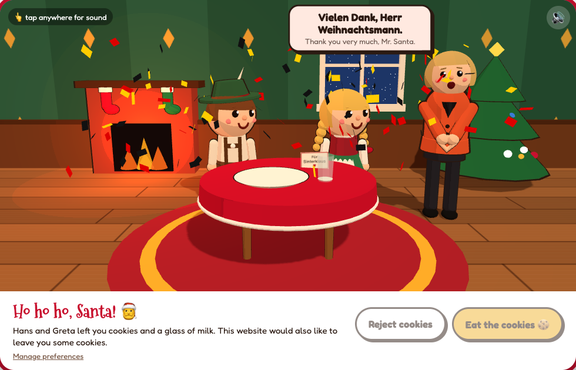
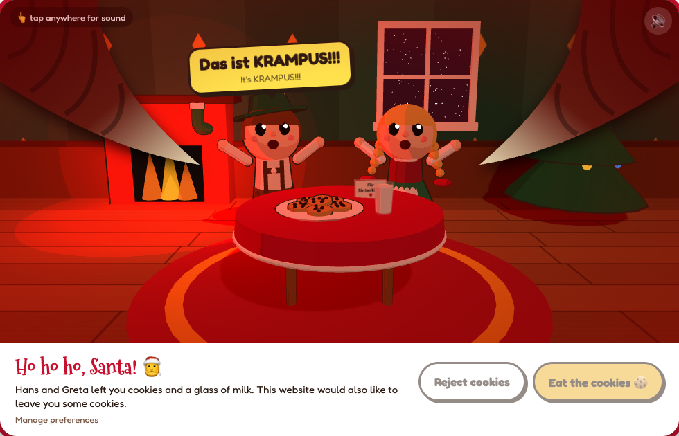

# Krampus Cookies 🍪👹

A whimsical 3D cookie-consent banner. You are Santa.

**▶ Live: https://sillycookies.timo.gg** (tap once for sound)

| Eat the cookies | Reject cookies |
|---|---|
|  |  |

- **Eat the cookies** → Santa munches the cookies and milk, then a cartoon Angela Merkel arrives to thank you. Sets `santa_consent=accepted`.
- **Reject cookies** → "Nein! Das ist nicht Sinterklaus! Das ist KRAMPUS!!" The kids flip the table and run. Sets `santa_consent=rejected`.
- **Manage preferences** → there are only cookies… or Krampus.

Static files only: Three.js 0.160 from jsDelivr, Web Audio for sound effects, the browser's `speechSynthesis` for voices.

```sh
python3 -m http.server -d public   # then open http://localhost:8000/?fresh
```

URL params: `?fresh` always shows the banner; `?auto=accept|reject|prefs` plays a sequence (for screenshots).

## Deploy

Live at https://sillycookies.timo.gg — an assets-only Cloudflare Worker (`wrangler.jsonc`) serving `public/`.
Pushes to `main` deploy via `.github/workflows/deploy.yml` once the repo has `CLOUDFLARE_API_TOKEN` and `CLOUDFLARE_ACCOUNT_ID` secrets. Manual deploy: `npx wrangler deploy`.
